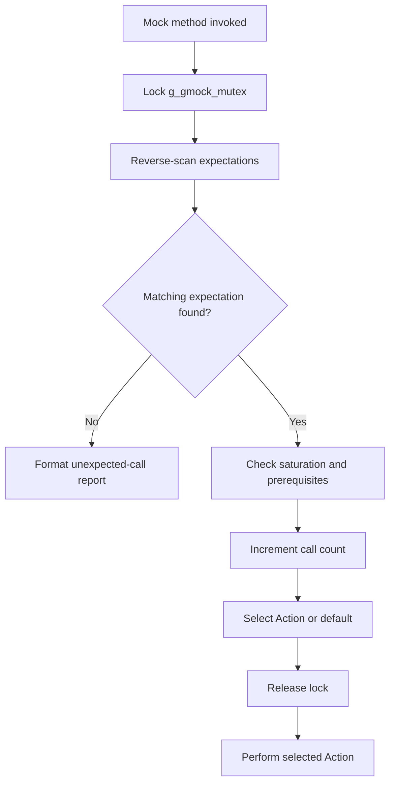
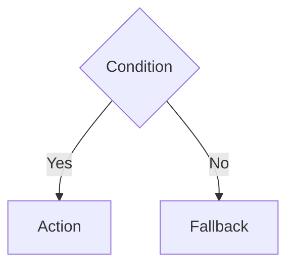

# Mermaid Authoring and Regression Rules

## The critical distinction: node labels vs edge labels

Node labels and flowchart edge labels have different syntax rules.

- Quote node labels when they contain or may contain spaces/special characters:
  - `A["Load Config"]`
  - `B{"Valid?"}`
- Do **not** quote labels inside pipe-delimited flowchart edges. The label between `|` delimiters is plain text:
  - Correct: `A -->|Yes| B`
  - Incorrect: `A -->|"Yes"| B`
  - Incorrect: `A -->| "No" | B`

The incorrect forms have caused GitHub Mermaid parse errors (the parser reported an unexpected `STR` token). Do not copy node-label quoting rules to pipe-delimited edge labels.

If a label requires quoting or contains punctuation that is unsafe in a pipe label, use Mermaid's middle-label form, such as `A -- "label with punctuation" --> B`, and test it with the exact target Mermaid version.

## Canonical flowchart example



## Validation states

Every Mermaid block must have exactly one explicit result:

- `passed`: a real Mermaid parser and renderer ran successfully.
- `failed`: static authoring lint or a real parser/renderer found an error.
- `not_run`: no parser/renderer executed. This is neither pass nor fail.

A Level 0 static check is a preflight only. It must never be described as successful Mermaid compilation.

## Required validation sequence

1. Extract every fenced Mermaid block from every generated Markdown page.
2. Run static authoring lint, including a quoted-pipe-edge-label regression check.
3. Run Mermaid.js `parse()` and `render()` with SVG output, or Mermaid CLI `mmdc`.
4. Record the renderer name/version and per-block outcome.
5. Fix failed blocks and repeat the real renderer check.
6. Report an overall pass only when every block is `passed`. If any block is `not_run`, report validation as incomplete.

## Regression fixtures

The following source must be rejected by static lint before rendering:

```mermaid
graph TD
  A{"Condition"} -->|"Yes"| B["Action"]
  A -->| "No" | C["Fallback"]
```

The corrected form must pass static lint and then be checked by a real Mermaid renderer:


