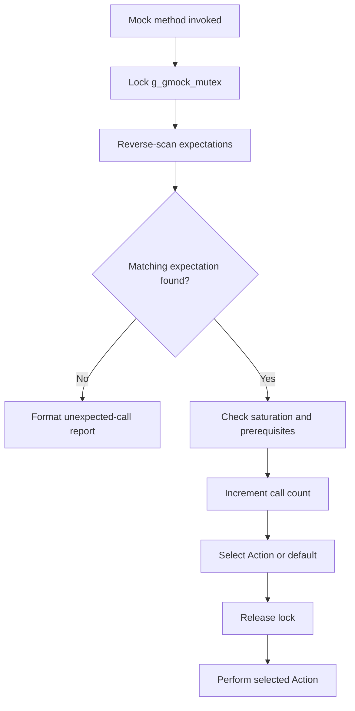

# Mermaid Authoring, Repair, and Regression Rules

## Authority and legacy-policy override

This packaged reference is authoritative for Mermaid authoring in this plugin. The pinned upstream `.apm/skills/wiki/references/mermaid_policy.md` contains legacy examples that quote pipe-delimited flowchart edge labels (for example `A -->|"Yes"| B`). Those edge-label examples are superseded by this reference. Keep the upstream source unchanged; apply this adapter rule whenever the upstream policy is loaded.

The distinction is:

- **Node labels** may and often should be quoted: `A["Load Config"]`, `B{"Valid?"}`.
- **Pipe-delimited flowchart edge labels** are plain text and must not have wrapper quotes: `A -->|Yes| B`.
- **Middle-label syntax** is different and may use quotes: `A -- "label with punctuation" --> B`.

Do not copy node-label quoting rules to pipe-delimited edge labels.

## Mandatory normalization before writing or final validation

When creating a Mermaid flowchart, emit unquoted pipe labels from the start. When reviewing existing/generated diagrams, run the packaged helper `tools/mermaid/mermaid_lint.py`:

```sh
python tools/mermaid/mermaid_lint.py path/to/page.md --check
python tools/mermaid/mermaid_lint.py path/to/page.md --repair --output /tmp/page.repaired.md
```

The repair pass is intentionally narrow and deterministic:

1. It only examines fenced `mermaid` blocks declared as `graph` or `flowchart`.
2. It recognizes a complete pipe-label payload wrapped in one pair of double quotes, optionally surrounded by whitespace, such as `A -->|"Yes"| B` or `A -->| "No" | B`.
3. It removes only the wrapper quotes and whitespace immediately surrounding the quoted token, preserving the label text, edge operator, indentation, and remaining source.
4. It does not modify node labels, sequence/class/state diagrams, inline Markdown, quoted middle-label syntax (`A -- "label" --> B`), or payloads containing embedded/escaped quotes where intent is ambiguous.
5. The helper writes to a separate output path and never overwrites the input. Review/merge only the affected generated/AUTOGEN content; preserve manual content outside generated markers.
6. Re-run `--check` on the repaired output. If a finding remains or cannot be safely normalized, mark authoring lint `unresolved` and report the exact line and manual correction needed. Never silently remove meaningful punctuation.

## Canonical flowchart example



## Separate authoring and renderer outcomes

Record two independent results for every Mermaid block:

- `authoring_lint`: `passed`, `repaired`, or `unresolved` .
- `renderer`: `passed`, `failed`, or `not_run`.

`repaired` means a deterministic source correction was applied and the post-repair lint passed. It is not a Mermaid parser result. `renderer=passed`�ɕ�եɕ́��ɕ���5�ɵ�������͕ȁ����MY�ɕ���ȸ��ɕ���ɕ����������ɕ�եɕ́������Յ�����͕Ƚɕ���ɕȁ��ɽȸ��ɕ���ɕ�����}�չ������́������͕Ƚɕ���ɕȁ�ᕍ�ѕ�쁥Ё�́���ѡ�ȁ�ɽ������م������х����ȁ�ɽ��������م������х�()����Ё����������ᅉ����ɔ�ɕ���ȁ���Ё���������́��5�ɵ������х�ɕ���ȁ�����ɔ��%����ͅ���ɕ���ȁ�Ս����́��Ё���ɕ���ɕȁ�չ̰�ɕ���Ё���ѡ�ɥ��}�����ɕ���ɕ��������ɕ���ɕ�����}�չ��((���I��ɕ�ͥ��������ɕ�((���������e�̉��	��������́������e����	���������͕́���Ё��ѕȁɕ���ȸ(����������9�����	��������́������9���	���������͕́���Ё��ѕȁɕ���ȸ(����������������������́�����������������͕́���Ё��ѕȁɕ���ȸ(����������̉����������́�������������������͕́���Ё��ѕȁɕ���ȸ(��������e����	��ɕ����́չ���������������͕́���и(�������������������	��ɕ����́չ�������������́��Ё��͍���ͥ�����(���l�9����������t�����e����	��ɕ����́չ�������쁹�����սѕ́�ɔ�ɕх�����()�ѕȁ�хѥ��ɕ���ȁ�������а��ո�5�ɵ�����́����͔�������́MY��ɕ���Ƞ�����ȁ5�ɵ����
1$��ݡ����م��������Mхѥ�������ɕ́��������ٕȁ�ɽٔ��չѥ���ɕ���ɥ���(